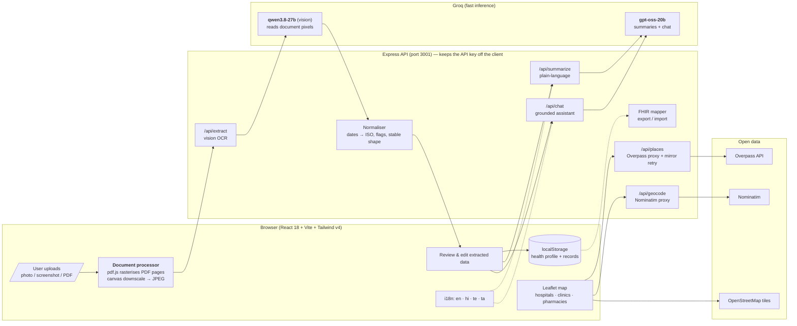

# Architecture — Ayu Copilot

AI-Powered Personal Health Copilot: an end-to-end pipeline that turns messy medical paperwork
into a structured, understandable, ABDM-ready health profile.

## 1. System & data pipeline



### Why this shape

| Decision | Reasoning |
| --- | --- |
| **Vision OCR (Groq qwen3.8-27b) instead of Tesseract.js** | Reads *pixels*, so handwritten prescriptions and bilingual/Indic documents work; Tesseract's Hindi/Telugu accuracy on doctor handwriting is poor. One model handles OCR + extraction in a single pass, with JSON mode for reliable structure. |
| **PDF rasterised in the browser (pdf.js)** | Scanned PDFs have no text layer, so text-extraction would fail. Rendering pages to JPEG makes PDFs take the *same* vision path as photos — one code path, consistent accuracy. |
| **Groq key only on the server** | The React app never sees the key; `/api/*` proxies every AI call. |
| **Records in `localStorage`, not a database** | Health data stays on the user's device (a genuine privacy story for the demo), and the prototype needs no auth/backend DB. |
| **Overpass + Nominatim proxied server-side** | Both mirrors have flaky CORS and rate limits; the server retries across 3 mirrors and adds a proper `User-Agent`. |

## 2. Data model (ABDM / FHIR-ready)

A saved record (internal shape) maps 1:1 onto FHIR R4 resources.

```json
{
  "id": "rec_x",
  "type": "lab_report | prescription | discharge_summary | diagnostic_report | imaging_report | other",
  "title": "Central Pathology Labs — Full Body Profile",
  "date": "2026-10-04",
  "provider": { "doctor": "Dr. Meera Patel", "facility": "Central Pathology Lab" },
  "medicines": [{ "name": "Metformin 500 mg", "dosage": "500 mg", "frequency": "twice daily", "duration": "90 days", "instructions": "after meals" }],
  "labs": [{ "test": "HbA1c", "value": "8.2", "unit": "%", "referenceRange": "4.0 - 5.6", "flag": "high" }],
  "vitals": [{ "name": "Blood Pressure", "value": "138/86", "unit": "mmHg", "flag": "normal" }],
  "diagnoses": [{ "name": "Type 2 Diabetes", "code": "E11.9" }],
  "notes": "Review after 3 months",
  "summary": "**What this document is** …",
  "summaryLang": "hi"
}
```

### FHIR R4 mapping (ABDM-aligned)

| Internal | FHIR resource | ABDM notes |
| --- | --- | --- |
| profile | `Patient` | `NDHM patient` profile, ABHA number as extension, ABHA address as identifier |
| record (document) | `DocumentReference` | `type` from SNOMED-ish code by record type |
| `labs[]` | `Observation` (`category = laboratory`) | value as `valueQuantity`, range as `referenceRange`, flag as `interpretation` |
| `vitals[]` | `Observation` (`category = vital-signs`) | same |
| `medicines[]` | `MedicationRequest` | dosage text + timing from frequency |
| `diagnoses[]` | `Condition` | ICD-10 in `code.coding` |

Everything is emitted as a `Bundle` of `transaction` entries — **Profile → Export FHIR bundle**
downloads it; **Import** restores it. This is the ABDM/ABHA-readiness story for Round 1.

## 3. Safety model (Healthcare Impact)

Enforced in `server/lib/prompts.js` and surfaced in the UI:

- **Never diagnoses** — abnormal values are explained against the *printed reference range* and routed to
  "discuss with your doctor"; the words "you have X" are forbidden.
- **Never adjusts medication** — "take exactly as your doctor prescribed".
- **Emergency guardrail** — the chat system prompt detects emergency language and answers with *call 108*.
- **Persistent disclaimer** — footer on every page, banner on Scan/Record/Chat, and a closing line in every summary.
- **Human correction** — the review step lets the user fix any OCR mistake before it becomes a record.

## 4. Request lifecycle (upload → insight)

1. File → `prepareDocument()` (pdf.js render or canvas downscale) → JPEG data URLs + a small thumbnail.
2. `POST /api/extract` with up to 3 page images → vision model → strict JSON → `normalizeRecord()`
   (ISO dates, flag normalisation, drop empty rows).
3. `POST /api/summarize` with that JSON + active language → plain-language summary.
4. User reviews/edits → record + thumbnail saved to `localStorage` → appears on the timeline,
   feeds the chat context, and is included in FHIR export.

## 5. Non-functional

- **Stateless API** — no session, no DB, no PHI at rest on the server.
- **Resilience** — Overpass retries across 3 mirrors; AI errors surface as readable messages, and a failed
  summary never blocks saving an extraction.
- **i18n** — one string table per language; the same language drives the LLM prompts, so UI and AI answers match.
- **Offline-ish** — timeline, chat history and profile keep working without the network (AI calls need it).
